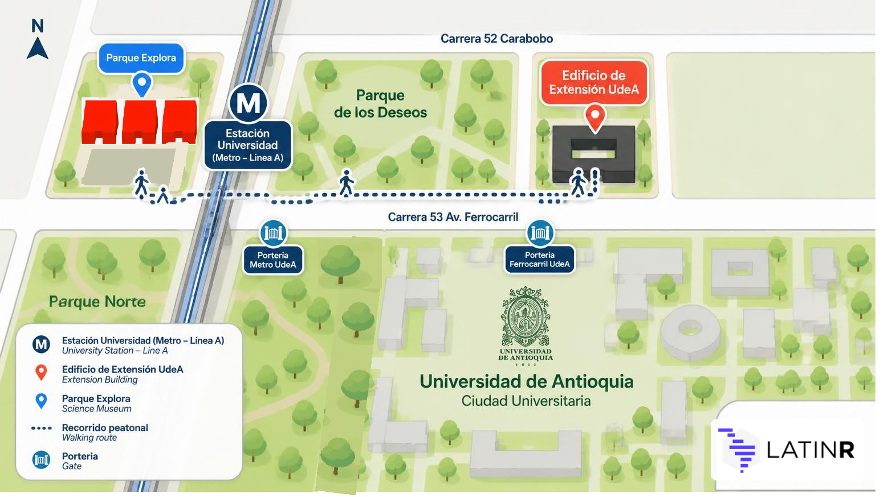
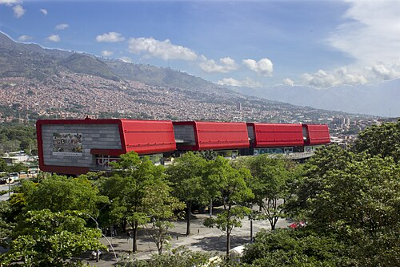
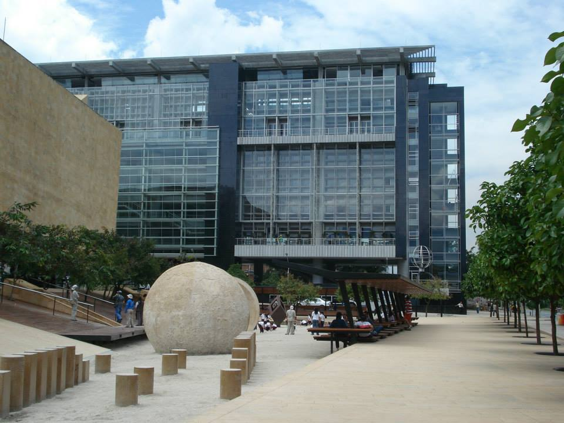

# Sede de LatinR 2026 — Medellín, Colombia

LatinR 2026 se realizará en la ciudad de **Medellín, Colombia**, distribuida en dos espacios emblemáticos de la ciudad:

- **Edificio de Extensión de la Universidad de Antioquia (UdeA)**
- **Auditorio de Parque Explora**

::: {.callout-important}
## ¡Verifica dónde se realiza cada actividad!

Es importante que verifiques la sede antes de desplazarte. Encontrarás esta información en el programa y en la aplicación, donde se indica el lugar de realización de cada actividad.

El **miércoles 11 de noviembre** todos los tutoriales se realizarán en el **Edificio de Extensión de la Universidad de Antioquia**. Los demás días habrá actividades en ambas sedes.
:::

Para facilitar tu orientación, este mapa esquemático muestra los principales puntos de referencia: la estación Universidad del Metro, los accesos a la Universidad (porterías Metro y Ferrocarril), el Edificio de Extensión y Parque Explora.

::: {#mapa}
{fig-alt="Mapa esquemático que muestra la estación Universidad del Metro (Línea A), Parque Explora al occidente de la estación, el Edificio de Extensión de la UdeA sobre la Carrera 52 Carabobo, el recorrido peatonal entre ambas sedes por la Carrera 53 Av. Ferrocarril y las porterías Metro y Ferrocarril de la Universidad de Antioquia." width="100%"}
:::

---

## Parque Explora

**Inauguración, Keynotes, Panel, Pósters, visitas al Acuario y a la Sala de Música, y Clausura**

::: {.columns}
::: {.column width="60%"}
[Parque Explora](https://www.parqueexplora.org/) es un museo interactivo de ciencia y tecnología ubicado en el corazón del centro de innovación de Medellín. Sus instalaciones ofrecen espacios modernos y versátiles ideales para grandes eventos académicos.

En Parque Explora se realizarán:

- 🎤 **Inauguración** de la conferencia
- 🎤 **Conferencias magistrales (Keynotes)**
- 💬 **Panel:** "Más allá del código: pensar, aprender y resolver con IA"
- 📋 **Pósters + cóctel**
- 🐟 **Visita al Acuario** (jueves) y 🎵 **a la Sala de Música** (viernes) de Parque Explora — ¡actividades especiales de la conferencia! ✨
- 👋 **Clausura**

**Dirección:** Carrera 52 #73-75, Medellín, Colombia - Auditorio, Piso 1
**Web:** [www.parqueexplora.org](https://www.parqueexplora.org/)
:::
::: {.column width="40%"}
{fig-alt="Vista de la sede de Parque Explora" width="100%"}
:::
:::

---

## Universidad de Antioquia — Edificio de Extensión

**Tutoriales, Charlas regulares, Charlas relámpago y HackeaR**

::: {.columns}
::: {.column width="60%"}
La [Universidad de Antioquia](https://www.udea.edu.co/) es una de las universidades públicas más importantes de Colombia y de América Latina. Su **Edificio de Extensión** cuenta con aulas y salones equipados para albergar actividades académicas de alto nivel.

En el Edificio de Extensión se realizarán:

- 📚 **Tutoriales**
- 🗣️ **Charlas regulares**
- ⚡ **Charlas relámpago**
- 💻 **[HackeaR](/cronograma/hackear/index.qmd)**

Las actividades se realizan en los auditorios de los pisos 2 y 3.

**Dirección:** Cl. 70 # 52 - 72, Medellín, Colombia  
**Web:** [www.udea.edu.co](https://www.udea.edu.co/)
:::
::: {.column width="40%"}
{fig-alt="Vista del edificio de extensión de la Universidad de Antioquia" width="100%"}
:::
:::

---

## Cómo llegar a Medellín

Medellín cuenta con el **Aeropuerto Internacional José María Córdova** (código IATA: MDE), ubicado en Rionegro, a aproximadamente 45 minutos del centro de la ciudad. También existe el aeropuerto doméstico **Olaya Herrera** (EOH) dentro de la ciudad.

Desde el aeropuerto se puede llegar al centro de Medellín mediante:

- 🚌 **Buses intermunicipales:** existen tres rutas de bus hacia Medellín: Terminal del Norte (zona norte), Nutibara (centro) y ruta sur, con paradas en San Diego y estación Metro Exposiciones.
- 🚕 Taxi o aplicaciones de transporte (Uber, InDriver, etc.)

### Movilidad en la ciudad

Medellín cuenta con un excelente sistema de transporte público integrado:

- **Metro** — Las líneas A y B conectan el centro con el norte, sur y occidente de Medellín.
- **Tranvía** — Conecta el centro y la estación San Antonio con la zona oriental incluyendo Buenos Aires y Miraflores.
- **Metro Cable** — Líneas aéreas que conectan barrios de las laderas con estaciones del Metro.
- **Bus integrado** — Buses alimentadores conectan barrios y municipios con estaciones del Metro.

## Cómo llegar a las sedes

Ambas sedes se encuentran en el sector Ciudad Universitaria, cerca del Jardín Botánico, el Planetario y el Parque Norte.

### En Metro: una opción práctica para llegar a las dos sedes

La estación de referencia para llegar tanto a la Universidad de Antioquia como a Parque Explora es **Universidad**, de la **Línea A**.

- **Si estás en una estación de la Línea A:** toma el tren en dirección a Niquía y desciende en la estación Universidad.
- **Si vienes por la Línea B:** realiza el transbordo en la estación San Antonio hacia la Línea A, en dirección a Niquía, y desciende en Universidad.
- **Si estás en el centro de Medellín:** puedes llegar a la estación San Antonio y tomar allí la Línea A en dirección norte (Niquía).

Desde la estación Universidad puedes acceder al campus de la Universidad de Antioquia y llegar caminando a Parque Explora. Para ingresar a la Universidad, utiliza la **portería Metro** o la **portería del Ferrocarril**, según el lugar al que debas dirigirte (revisa el [mapa](#mapa)).

Puedes consultar la información oficial del sistema en [Metro de Medellín](https://www.metrodemedellin.gov.co/). Más opciones de acceso en [Cómo llegar a Parque Explora](https://www.parqueexplora.org/visitanos/como-llegar).
