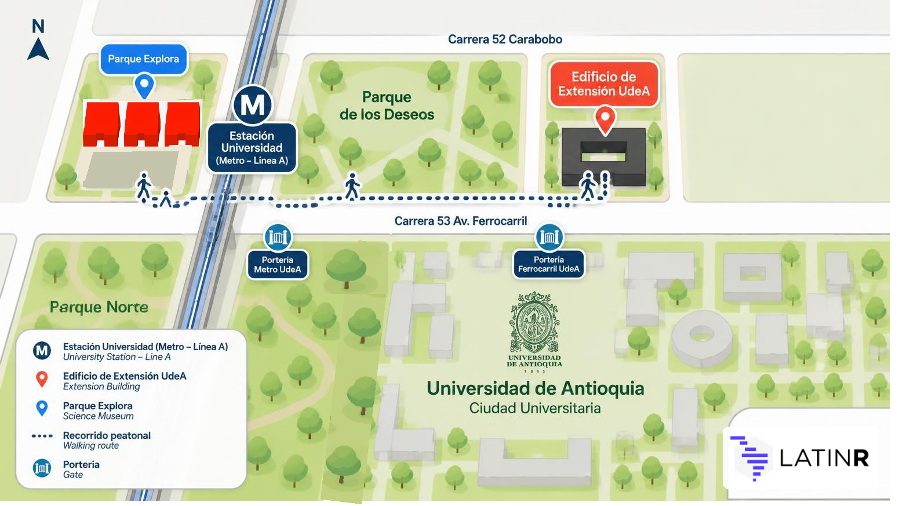
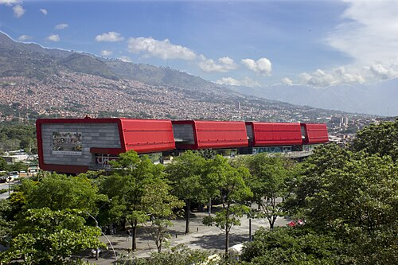
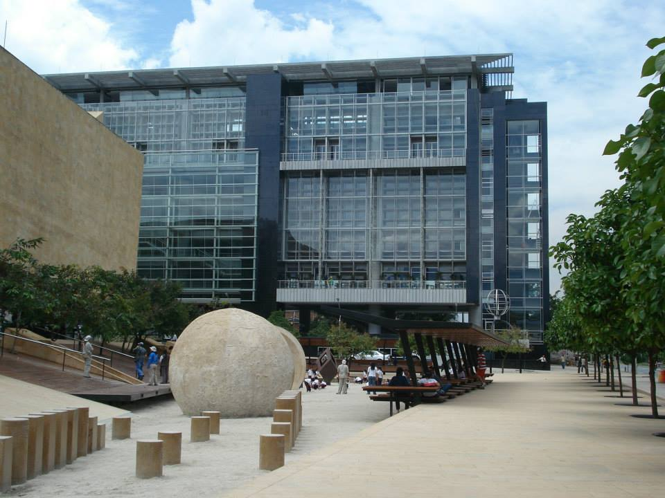

# LatinR 2026 Venue — Medellín, Colombia

LatinR 2026 will take place in **Medellín, Colombia**, across two iconic venues in the city:

- **Edificio de Extensión (Extension Building) at Universidad de Antioquia (UdeA)**
- **Parque Explora Auditorium**

::: {.callout-important}
## Check where each activity takes place!

Please check the venue before you head out. You will find this information in the program and in the app, where the venue of each activity is listed.

On **Wednesday, November 11**, all tutorials will take place at the **Edificio de Extensión of Universidad de Antioquia**. On the other days, there will be activities at both venues.
:::

To help you find your way, this schematic map shows the main landmarks: Universidad Metro station, the University entrances (Metro and Ferrocarril gates), the Edificio de Extensión, and Parque Explora.

::: {#map}
{fig-alt="Schematic map showing Universidad Metro station (Line A), Parque Explora to the west of the station, the UdeA Edificio de Extensión on Carrera 52 Carabobo, the walking route between both venues along Carrera 53 Av. Ferrocarril, and the Metro and Ferrocarril gates of Universidad de Antioquia." width="100%"}
:::

---

## Parque Explora

**Opening, Keynotes, Panel, Posters, Aquarium and Music Room visits, and Closing**

::: {.columns}
::: {.column width="60%"}
[Parque Explora](https://www.parqueexplora.org/) is an interactive science and technology museum located in the heart of Medellín's innovation district. Its modern and versatile facilities are ideal for large academic events.

Parque Explora will host:

- 🎤 **Opening ceremony**
- 🎤 **Keynote talks**
- 💬 **Panel:** "Más allá del código: pensar, aprender y resolver con IA" (Beyond code: thinking, learning, and solving with AI)
- 📋 **Posters + cocktail**
- 🐟 **Visit to the Aquarium** (Thursday) and 🎵 **the Music Room** (Friday) at Parque Explora — special conference activities! ✨
- 👋 **Closing ceremony**

**Address:** Carrera 52 #73-75, Medellín, Colombia - Auditorium, Floor 1
**Website:** [www.parqueexplora.org](https://www.parqueexplora.org/)
:::
::: {.column width="40%"}
{fig-alt="Exterior view of Parque Explora in Medellín" width="100%"}
:::
:::

---

## Universidad de Antioquia — Edificio de Extensión

**Tutorials, Regular talks, Lightning talks, and HackeaR**

::: {.columns}
::: {.column width="60%"}
The [Universidad de Antioquia](https://www.udea.edu.co/) is one of the most important public universities in Colombia and Latin America. Its **Edificio de Extensión** (Extension Building) provides fully equipped classrooms and halls for high-level academic activities.

The Edificio de Extensión will host:

- 📚 **Tutorials**
- 🗣️ **Regular talks**
- ⚡ **Lightning talks**
- 💻 **[HackeaR](/cronograma/hackear/hackear-en.qmd)**

Activities take place in the auditoriums on floors 2 and 3.

**Address:** Cl. 70 # 52 - 72, Medellín, Colombia
**Website:** [www.udea.edu.co](https://www.udea.edu.co/)
:::
::: {.column width="40%"}
{fig-alt="View of the extension building of Universidad de Antioquia" width="100%"}
:::
:::

---

## Getting to Medellín

Medellín is served by **José María Córdova International Airport** (IATA code: MDE), located in Rionegro, approximately 45 minutes from the city centre. The domestic **Olaya Herrera Airport** (EOH) is also located within the city.

From the international airport you can reach central Medellín by:

- 🚌 **Intercity buses:** there are three bus routes to Medellín: Terminal del Norte (North Bus Terminal, north area), Hotel Nutibara (downtown), and the south route, with stops at San Diego and Exposiciones Metro station.
- 🚕 Taxi or ride-sharing apps (Uber, InDriver, etc.)

### Getting around the city

Medellín has an excellent integrated public transport system:

- **Metro** — Lines A and B connect downtown Medellín with the north, south, and western areas of the city.
- **Tram** — Connects downtown and San Antonio Station with the eastern area of the city, including Buenos Aires and Miraflores.
- **Cable car (Metrocable)** — Cable car lines connect hillside neighborhoods with Metro stations.
- **Integrated bus** — Feeder and local buses connect neighborhoods and nearby towns with the Metro system.

## Getting to the venues

Both venues are located in the University City area, near the Botanical Garden, the Planetarium, and Parque Norte.

### By Metro: a convenient way to reach both venues

The reference station for both Universidad de Antioquia and Parque Explora is **Universidad**, on **Line A**.

- **If you are at a Line A station:** take the train towards Niquía and get off at Universidad station.
- **If you are coming on Line B:** transfer at San Antonio station to Line A, towards Niquía, and get off at Universidad.
- **If you are in downtown Medellín:** go to San Antonio station and take Line A northbound (towards Niquía).

From Universidad station you can enter the Universidad de Antioquia campus and walk to Parque Explora. To enter the University, use the **Metro gate** (portería Metro) or the **Ferrocarril gate** (portería del Ferrocarril), depending on where you are going (see the [map](#map)).

Official information about the system is available on the [Metro de Medellín](https://www.metrodemedellin.gov.co/) website. More access options at [How to get to Parque Explora](https://www.parqueexplora.org/visitanos/como-llegar) (in Spanish).
