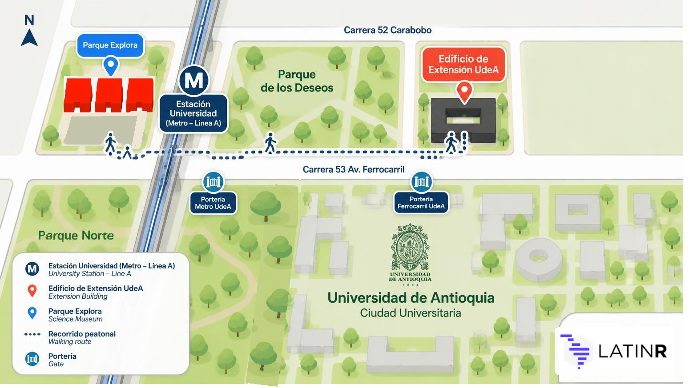
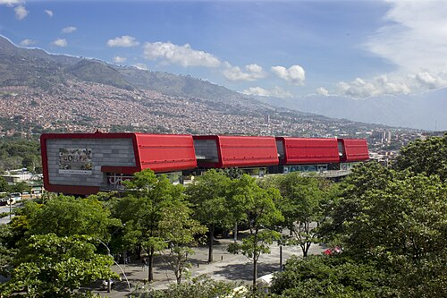
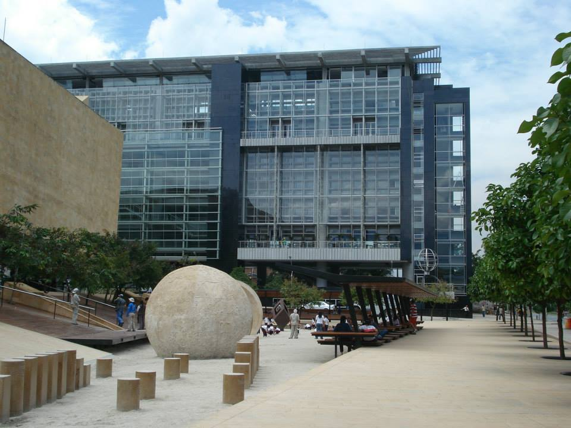

# Sede do LatinR 2026 — Medellín, Colômbia

O LatinR 2026 será realizado na cidade de **Medellín, Colômbia**, em dois espaços emblemáticos da cidade:

- **Edificio de Extensión da Universidad de Antioquia (UdeA)**
- **Auditório do Parque Explora**

::: {.callout-important}
## Confira onde cada atividade será realizada!

É importante que você confira o local antes de se deslocar. Essa informação está no programa e no aplicativo, onde é indicado o local de cada atividade.

Na **quarta-feira, 11 de novembro**, todos os tutoriais serão realizados no **Edificio de Extensión da Universidad de Antioquia**. Nos demais dias, haverá atividades nos dois locais.
:::

Para facilitar sua orientação, este mapa esquemático mostra os principais pontos de referência: a estação Universidad do metrô, os acessos à Universidade (portarias Metro e Ferrocarril), o Edificio de Extensión e o Parque Explora.

::: {#mapa}
{fig-alt="Mapa esquemático que mostra a estação Universidad do metrô (Linha A), o Parque Explora a oeste da estação, o Edificio de Extensión da UdeA na Carrera 52 Carabobo, o percurso a pé entre os dois locais pela Carrera 53 Av. Ferrocarril e as portarias Metro e Ferrocarril da Universidad de Antioquia." width="100%"}
:::

---

## Parque Explora

**Abertura, Keynotes, Painel, Pôsters, visitas ao Aquário e à Sala de Música, e Encerramento**

::: {.columns}
::: {.column width="60%"}
O [Parque Explora](https://www.parqueexplora.org/) é um museu interativo de ciência e tecnologia localizado no coração do distrito de inovação de Medellín. Suas instalações modernas e versáteis são ideais para grandes eventos acadêmicos.

No Parque Explora serão realizados:

- 🎤 **Abertura** da conferência
- 🎤 **Palestras convidadas (Keynotes)**
- 💬 **Painel:** "Más allá del código: pensar, aprender y resolver con IA" (Além do código: pensar, aprender e resolver com IA)
- 📋 **Pôsters + coquetel**
- 🐟 **Visita ao Aquário** (quinta-feira) e 🎵 **à Sala de Música** (sexta-feira) do Parque Explora — atividades especiais da conferência! ✨
- 👋 **Encerramento**

**Endereço:** Carrera 52 #73-75, Medellín, Colômbia - Auditório, 1º andar
**Site:** [www.parqueexplora.org](https://www.parqueexplora.org/)
:::
::: {.column width="40%"}
{fig-alt="Vista exterior do Parque Explora em Medellín" width="100%"}
:::
:::

---

## Universidad de Antioquia — Edificio de Extensión

**Tutoriais, Palestras regulares, Palestras relâmpago e HackeaR**

::: {.columns}
::: {.column width="60%"}
A [Universidad de Antioquia](https://www.udea.edu.co/) é uma das universidades públicas mais importantes da Colômbia e da América Latina. Seu **Edificio de Extensión** (Prédio de Extensão) conta com salas de aula e salões equipados para atividades acadêmicas de alto nível.

O Edificio de Extensión irá receber:

- 📚 **Tutoriais**
- 🗣️ **Palestras regulares**
- ⚡ **Palestras relâmpago**
- 💻 **[HackeaR](/cronograma/hackear/hackear-pt.qmd)**

As atividades acontecem nos auditórios do 2º e do 3º andar.

**Endereço:** Cl. 70 # 52 - 72, Medellín, Colômbia
**Site:** [www.udea.edu.co](https://www.udea.edu.co/)
:::
::: {.column width="40%"}
{fig-alt="Vista do Edificio de Extensión da Universidad de Antioquia" width="100%"}
:::
:::

---

## Como chegar a Medellín

Medellín possui o **Aeroporto Internacional José María Córdova** (código IATA: MDE), localizado em Rionegro, a aproximadamente 45 minutos do centro da cidade. O aeroporto doméstico **Olaya Herrera** (EOH) fica dentro da cidade.

Do aeroporto internacional é possível chegar ao centro de Medellín por:

- 🚌 **Ônibus intermunicipais:** há três linhas de ônibus para Medellín: Terminal del Norte (Rodoviária Norte), Hotel Nutibara (centro) e a rota sul, com paradas em San Diego e na estação Exposiciones do metrô.
- 🚕 Táxi ou aplicativos de transporte (Uber, InDriver, etc.)

### Locomoção na cidade

Medellín conta com um excelente sistema de transporte público integrado:

- **Metrô** — As linhas A e B conectam o centro de Medellín às zonas norte, sul e oeste da cidade.
- **VLT/Bonde** — Conecta o centro e a estação San Antonio à zona leste da cidade, incluindo Buenos Aires e Miraflores.
- **Teleférico (Metrocable)** — Linhas de teleférico conectam bairros nas encostas às estações do metrô.
- **Ônibus integrado** — Linhas alimentadoras conectam bairros e municípios próximos ao sistema de metrô.

## Como chegar aos locais

Os dois locais ficam na região da Cidade Universitária, perto do Jardim Botânico, do Planetário e do Parque Norte.

### De metrô: uma opção prática para chegar aos dois locais

A estação de referência para chegar tanto à Universidad de Antioquia quanto ao Parque Explora é **Universidad**, da **Linha A**.

- **Se você estiver em uma estação da Linha A:** pegue o trem em direção a Niquía e desça na estação Universidad.
- **Se você vier pela Linha B:** faça a baldeação na estação San Antonio para a Linha A, em direção a Niquía, e desça em Universidad.
- **Se você estiver no centro de Medellín:** vá até a estação San Antonio e pegue ali a Linha A em direção norte (Niquía).

Da estação Universidad você pode entrar no campus da Universidad de Antioquia e chegar a pé ao Parque Explora. Para entrar na Universidade, use a **portaria Metro** ou a **portaria Ferrocarril**, de acordo com o local para onde você vai (veja o [mapa](#mapa)).

Consulte as informações oficiais do sistema no site do [Metro de Medellín](https://www.metrodemedellin.gov.co/). Mais opções de acesso em [Como chegar ao Parque Explora](https://www.parqueexplora.org/visitanos/como-llegar) (em espanhol).
